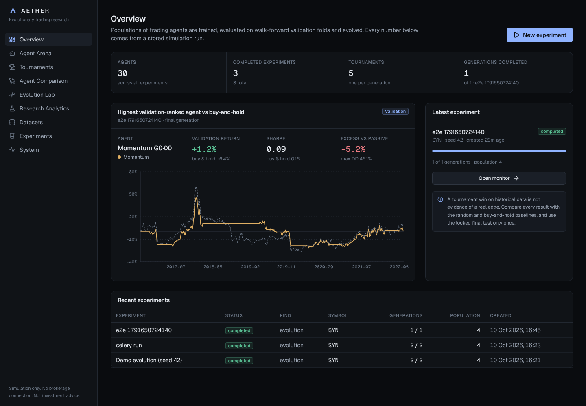

# AETHER: Autonomous Evolutionary Trading Arena

AETHER is a research platform for asking a careful question: *can a population of
trading agents, trained and evolved on historical data, find anything that
survives honest out-of-sample evaluation?* It trains rule-based and machine
learning agents, evaluates them on purged walk-forward validation folds with
realistic costs, ranks them under a documented policy, evolves their genomes
over generations, and keeps the most recent part of the data locked away until
you explicitly run a one-time final test.

> **Historical simulation and paper research only.** AETHER never places
> orders, never connects to a brokerage, holds no account credentials, and makes
> no claim that any strategy is profitable. Nothing it produces is investment
> advice. Results on synthetic data say nothing about real markets.



## What is in the box

| Area | What it does |
| --- | --- |
| **Data** | Seeded synthetic market (regime-switching, shared market factor), CSV/Parquet upload, optional Yahoo Finance import (off by default). Every dataset is validated, cleaned, content-hashed and stored immutably. |
| **Features** | 25 point-in-time features (returns, trend, volatility, RSI/MACD, volume, benchmark regime). A feature at day *t* uses bars up to the close of *t* only. |
| **Agents** | Random (Markov), Buy & Hold, Momentum (MA cross / time-series momentum), Random Forest, XGBoost, PyTorch MLP. Each has a typed, bounded genome. |
| **Simulator** | Event-driven daily simulator: decide at close *t*, fill at open *t+1*, proportional + fixed fees, slippage, long-only, no leverage, risk manager with position caps, turnover limits, volatility targeting and a drawdown circuit breaker. |
| **Validation** | Locked final test split, then expanding (or rolling) walk-forward folds with label purging and an embargo. |
| **Tournaments** | Same folds, costs and risk rules for every agent; ranking policy that rewards consistent risk-adjusted performance, excludes reckless agents and flags thin evidence; statistical warnings on every result. |
| **Evolution** | Elitism, tournament selection, bounded mutation, same-family crossover, random immigrants, full lineage, cached re-evaluation of identical genomes. |
| **Optimisation** | Optional Optuna studies (TPE + median pruning) on validation folds only. |
| **Tracking** | Experiment manifest (config, dataset hash, code version, dependency versions, seeds), artifact store with SHA-256 verification on every load, durable job records. |
| **API** | Versioned FastAPI (`/api/v1`), background jobs (in-process or Celery + Redis), idempotent creation, cancellation, resource limits, optional API key. |
| **Dashboard** | Next.js: Overview, Agent Arena and agent detail, Tournaments leaderboard, Agent Comparison, Evolution Lab (lineage graph), Research Analytics, Datasets, Experiments (builder and live monitor), System. |

Design notes: [architecture](docs/architecture.md) ·
[methodology](docs/methodology.md) · [evaluation](docs/evaluation.md) ·
[limitations](docs/limitations.md) · [original plan](docs/PLAN.md)

## Quick start (local, no Docker)

Requirements: Python 3.12+ with [uv](https://docs.astral.sh/uv/), Node 22.

```bash
make install          # uv sync + npm ci (see the note on PyTorch below)
make demo             # SQLite DB, synthetic data, 3 generations x 8 agents (~30-60 s)
make dev              # API on :8000 and dashboard on :3000
```

Open http://localhost:3000. The demo experiment appears on the Overview page;
from its monitor page you can run the locked final test.

Without `make`:

```bash
uv sync
uv run alembic -c services/api/alembic.ini upgrade head
uv run aether demo --generations 3 --population 8 --seed 42
uv run uvicorn aether_api.main:app --port 8000
cd apps/web && npm ci && npm run dev
```

Defaults need no configuration: SQLite at `./aether.db`, datasets in
`datasets/store/`, artifacts in `artifacts/`, jobs run in a bounded in-process
pool. See [`.env.example`](.env.example) for every setting (`AETHER_*`).

**PyTorch size.** `uv sync` installs the default PyPI torch wheel, which on Linux
pulls several GB of CUDA libraries that AETHER does not need. For a CPU-only
environment with the same locked versions of everything else:

```bash
scripts/install-cpu.sh .venv --dev
uv pip install --no-deps -e packages/trading_engine -e services/api
```

## Real market data (Yahoo Finance, optional)

The demo uses synthetic data so it runs offline. To research real instruments,
install the optional `yfinance` extra and import daily bars. Yahoo data is
unofficial, is split and dividend adjusted, and is subject to Yahoo's terms. It
is fine for prototyping and is not institution-grade.

```bash
uv sync --all-packages --all-extras                     # adds yfinance
uv run aether import-yahoo --symbols SPY --start 2005-01-01
uv run aether datasets                                  # note the dataset id
uv run aether experiment --dataset <id> --symbol SPY --generations 3 --population 8
```

Every import is validated and stored as an immutable, content-hashed version.
Re-importing later (new bars, revised history) creates a new version, and old
experiments keep pointing at the exact bytes they used. The most recent 20% of
the series (`--test-fraction`) is locked away as the final test. Evolution and
ranking only ever see the earlier development period.

To import from the dashboard's **Datasets** page instead, set
`AETHER_ENABLE_YAHOO=true` in `.env` and restart the API. The API keeps it off
by default, so a public deployment cannot be used to make outbound calls.

On Windows without `make`, run the same commands with `python -m uv run ...`.

## Deploying a read-only showcase (Vercel)

The dashboard can be published on its own, with no Python API, database or
training worker, as a read-only showcase of results you computed locally.

1. Run experiments locally, then export them:
   `uv run python scripts/export_snapshot.py` (or `make snapshot`). This writes
   real API responses for every completed experiment to
   `apps/web/public/snapshot/`. Pass `--experiment <id>` (repeatable) to export
   only some. The export refuses to finish if any file contains a local path,
   and the System page is replaced with a description of the snapshot.
2. Commit and push `apps/web/public/snapshot/`.
3. On [vercel.com/new](https://vercel.com/new), import the GitHub repository
   and set **Root Directory** to `apps/web`. No environment variables are
   needed: on Vercel, `next.config.ts` turns on snapshot mode
   (`NEXT_PUBLIC_AETHER_SNAPSHOT=true`) and fills in the GitHub link
   automatically.

In snapshot mode the API client reads `/snapshot/*.json` and applies the
API's own filtering and pagination in the browser. Anything that would change
state (new experiments, imports, final tests) shows a read-only message. To
update the live site, re-run the export, commit and push. Vercel redeploys on
push.

A fully live deployment (Vercel dashboard + hosted API, worker, Postgres and
Redis) is described under Docker Compose below. Set
`NEXT_PUBLIC_AETHER_SNAPSHOT=false` and `NEXT_PUBLIC_API_URL` on Vercel for that.

## Full stack with Docker Compose

```bash
cp .env.example .env
docker compose up --build -d             # postgres, redis, api, worker, web
docker compose exec api aether demo      # seed a demo experiment
```

Dashboard at http://localhost:3000, API at http://localhost:8000/docs. The API
container runs Alembic migrations on start; training runs in the separate
`worker` container (Celery, queue `training`, CPU and memory limits set in
`.env`). Datasets and model artifacts live in the shared `aetherdata` volume.

## Using it

1. **Datasets**: import synthetic data (any seed, symbols, date range) or upload
   a CSV/Parquet file. Validation issues are shown per dataset.
2. **New experiment**: pick dataset, symbol, algorithm families, population,
   generations, costs and risk limits. The form shows the workload (fits and
   simulations) before you start.
3. **Monitor**: progress per generation, jobs, cancellation. Every number is
   computed from stored simulations.
4. **Tournaments / Compare / Evolution Lab / Analytics**: inspect the ranking,
   why an agent ranked where it did, fold-by-fold stability, lineage and
   mutations, parameter sensitivity, and how much of the best score selection
   bias alone would explain.
5. **Final test**: run once at the end. Re-running is possible only with an
   explicit acknowledgement and permanently marks the experiment as
   test-contaminated.

## Commands

| Command | Purpose |
| --- | --- |
| `make test` | Python tests (engine + API integration) and dashboard unit tests |
| `make lint` / `make typecheck` | Ruff + ESLint / mypy + tsc |
| `make e2e` | Playwright smoke test (API with demo data on :8000, dashboard on :3000) |
| `make up` / `make down` | Docker Compose stack |
| `make help` | Everything else |

## Test status

Measured on this branch (Linux, Python 3.13, Node 22):

| Suite | Result |
| --- | --- |
| `pytest` (engine + API, incl. full lifecycle, final-test lock, Optuna, cancellation, leakage tests) | 93 passed |
| `ruff check`, `ruff format --check`, `mypy` | clean |
| Vitest (formatting, series maths, genome diff, builder validation, API client, components) | 24 passed |
| ESLint, `tsc --noEmit`, `next build` | clean |
| Playwright smoke (all pages, leaderboard to agent detail, builder validation, create and run an experiment) | 14 passed |
| Postgres + Redis + Celery worker path | demo experiment, final test and Optuna study completed |

## Repository layout

```
packages/trading_engine/   research engine (no web or DB dependencies)
services/api/              FastAPI app, SQLAlchemy models, Alembic, jobs, Celery worker
apps/web/                  Next.js dashboard
infra/docker/              Dockerfiles (API/worker image, web image)
docs/                      architecture, methodology, evaluation, limitations
scripts/                   install-cpu.sh
```

## Safety boundaries

- No order placement, broker SDKs or account credentials anywhere in the code.
- No arbitrary code execution: agents are built from typed genomes only; the
  API accepts configuration, never Python or shell.
- Model artifacts are loaded only after their SHA-256 matches the database
  record; RandomForest pickles are never loaded from user uploads. XGBoost uses
  its JSON format and PyTorch uses `weights_only=True`.
- Every mutating endpoint is rate-limited and bounded by server-side limits
  (population, generations, trials, job duration, upload size, concurrency). Set
  `AETHER_API_KEY` to require a key; the API refuses to start in production
  without one.
